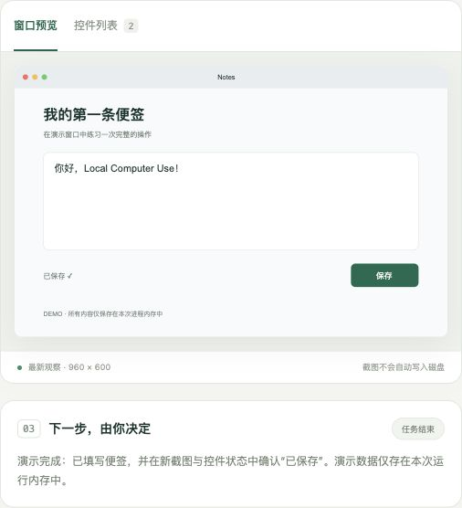

# Local Computer Use

一个可以在自己 Mac 上运行、检查和修改的电脑操作助手。选择窗口，用自然语言描述任务，查看模型准备做什么，批准后执行，再用新的窗口截图检查结果。

**macOS 原生操作 · 中文界面 · 每步批准 · 无第三方 Python 依赖 · MIT 开源**

An open-source, local macOS computer-use agent with native accessibility, window screenshots, a review UI and an OpenAI Responses API adapter. Independently implemented; not affiliated with OpenAI and not a copy of proprietary Codex tools.



## 能做什么

| 能力 | 实现 |
|---|---|
| 选择目标窗口 | 列出当前可见的普通应用窗口；每个任务固定一个窗口 |
| 读取界面 | macOS Accessibility 控件树，带角色、名称、值及当前观察的控件 ID |
| 理解画面 | ScreenCaptureKit 捕获所选窗口，最长宽度 1440 像素 |
| 执行操作 | 点击、双击、填写控件、Unicode 输入、常用按键、垂直滚动 |
| 模型规划 | OpenAI Responses API + 自定义函数工具；一次只提出一步 |
| 人工控制 | 每一步展示理由和参数；批准、拒绝、停止；预览超时自动停止 |
| 检查结果 | 每次动作后重新观察；展示最新截图、控件和时间线 |
| 离线体验 | 固定便签演示，不用 API Key、不申请权限、不控制真实电脑 |

这是可运行的初版，重点是**单窗口操作闭环**。尚未提供跨窗口任务、浏览器 DOM 插件、拖拽、OCR、后台无人值守模式或打包签名的 `.app`。

## 先试用演示

需要 Python 3.10 或更新版本。演示可运行于 macOS、Linux 或 Windows。

```sh
git clone https://github.com/zbw123456/local-computer-use.git
cd local-computer-use
python3 -m localcu --demo
```

浏览器会自动打开。点击“开始任务”，依次批准“填写便签”和“保存”，就能看到完整闭环。演示文字和流程是固定的，不代表模型能力；便签只保存在进程内存中。Mac 上也可以双击 `start-demo.command`。

## 操作真实 Mac

需要 macOS 14+、Python 3.10+、Xcode Command Line Tools（Swift 5.9+），以及支持图像输入和函数调用的 Responses API 模型。

### 1. 编译原生组件

如果没有 Apple 开发工具，先运行 `xcode-select --install` 并按系统提示完成安装。然后：

```sh
./scripts/build-native.sh
cp .env.example .env
```

### 2. 在本机配置模型

用文本编辑器打开 `.env`，填入自己的 API Key：

```dotenv
OPENAI_API_KEY=你的密钥
OPENAI_MODEL=gpt-5.4
OPENAI_BASE_URL=https://api.openai.com/v1
```

默认模型是一个明确、可修改的配置，不会自动切换到其他模型。你需要拥有相应 API 访问权限和额度；项目不包含免费 API 额度。环境变量优先于 `.env`，修改后需要重启。

**不要把 API Key 发给别人或提交到 Git。** `.env` 已被忽略。程序不会在浏览器里展示密钥，也不会把密钥写入审计日志。`.env` 是本机明文配置；可用 `chmod 600 .env` 限制文件访问，或改用环境变量。

### 3. 启动并授权

```sh
python3 -m localcu
```

也可以双击 `start.command`。首次使用时，在页面点击“申请 macOS 权限”，按提示到“系统设置 → 隐私与安全性”启用：

- **辅助功能**：允许读取控件、点击和输入。
- **屏幕录制 / 屏幕与系统音频录制**：允许截取窗口。

macOS 可能把权限归到启动程序（Terminal、iTerm 或 IDE），也可能显示原生 helper。以系统实际提示为准。更改权限后，完全退出并重新打开启动终端与本服务，再点击“检查连接状态”。程序不会自动打开权限开关。

### 4. 执行第一个任务

1. 打开一个普通文本编辑应用的空白文档。
2. 在页面选择该文档窗口，点击“查看窗口和控件”。
3. 输入简单目标，例如“在当前空白文档写下三条学习计划，暂不保存”。
4. 检查截图、操作内容和目标控件，再批准当前一步。
5. 需要中断时点击“停止”；退出服务则在终端按 `Ctrl+C`。

任务执行时请不要手动移动窗口、切换文档或操作目标应用。遇到新窗口、保存对话框或权限弹窗，先手动处理，再选择正确窗口启动新任务。

## 本地运行的含义

网页服务、状态机、截图、系统操作都运行在本机，监听地址固定为 `127.0.0.1`。**默认模型推理使用云端 API**：任务、所选窗口截图和控件文本会发送到配置的模型端点。不要在含有密码、私人通信或其他不准备发送的内容的窗口中启动任务。

演示模式完全离线。你也可以设置本机 `OPENAI_BASE_URL`，但本地服务必须兼容 **Responses API、图像输入、strict function tools、工具结果和 `reasoning.encrypted_content` 参数**；普通 Chat Completions 接口不能直接替代。此兼容路径尚未针对具体本地模型服务验证。

网页中的“停止”阻止后续步骤，不能撤回已经发给系统的一次点击或输入。正在进行的模型请求最长等待 45 秒，原生调用最长 25 秒；停止后迟到的模型建议会被丢弃。长输入以多个系统事件发出，已经开始的输入步骤不会逐字符取消。

## 配置与开发

```sh
# 另选本机端口；限制操作步数和总时长
python3 -m localcu --port 8766 --max-steps 10 --max-seconds 300

# 不打开浏览器 / 不记录审计元数据
python3 -m localcu --no-browser --no-audit

# 自动化测试，无需 API Key 和 macOS 权限
python3 -m unittest discover -s tests -v

# 原生协议冒烟测试，不触发权限申请或桌面动作
python3 scripts/smoke-native.py
```

默认最多 20 次操作、10 分钟，每条建议 120 秒内有效。总时长在调用之间检查，已在途的网络或系统调用会受各自超时限制。最后一次操作后可以再调用一次模型来检查结果。

```text
localcu/                 Python 服务、任务状态机、模型适配器
  static/                无构建工具的 HTML / CSS / JavaScript 界面
native/                  Swift 原生窗口读取与操作组件
scripts/                 编译与原生冒烟验证
tests/                   操作约束、停止、批准、模型协议、HTTP 安全测试
docs/                    架构、权限、验证记录与开发路线
.local/                  本机编译产物和审计元数据，Git 忽略
.env                     本机密钥配置，Git 忽略
```

Python 标准库直接调用 API，不需要 `pip install`。Swift 仅使用 Apple 系统框架，没有第三方包。前端无 CDN、统计代码或外部字体。

## 验证与限制

本地已通过原生 Release 编译、JSONL 协议检查、18 项自动化测试，以及浏览器中的完整演示流程。实际验证环境、尚未验证的部分和复现方法见 [验证记录](docs/TESTING.md)。

创建初版时，本机缺少新组件的屏幕录制权限，且没有配置模型 API Key，因此**尚未完成真实桌面 + 真实模型的端到端验证**。截图和原生操作的兼容性仍需在你授权后、针对实际应用检查。截图工具不可用时会停止，不会凭空生成观察。

控件树最多 350 个节点、12 层；部分游戏、画布、Electron 应用或自绘控件可能没有足够的辅助功能信息。坐标操作必须能通过 macOS 命中测试验证目标窗口；不满足条件时会拒绝。密码框的辅助功能值被隐藏，文字输入被拒绝，但截图不会进行通用内容脱敏。

按钮可能触发联网、发送、删除等实际效果，逐步批准不是应用级沙箱。请先在无敏感内容、可恢复的练习窗口中使用。[安全设计与边界](docs/SECURITY.md) 说明了具体机制与局限。

## 文档与参考

- [架构和原生协议](docs/ARCHITECTURE.md)
- [权限配置与排错](docs/TROUBLESHOOTING.md)
- [验证记录](docs/TESTING.md)
- [后续路线](docs/ROADMAP.md)
- [OpenAI Function calling](https://developers.openai.com/api/docs/guides/function-calling)
- [OpenAI Images and vision](https://developers.openai.com/api/docs/guides/images-vision)
- [OpenAI Computer use](https://developers.openai.com/api/docs/guides/tools-computer-use)
- [GPT-5.4 模型能力](https://developers.openai.com/api/docs/models/gpt-5.4)
- [Apple Accessibility API](https://developer.apple.com/documentation/applicationservices/axuielement)
- [Apple ScreenCaptureKit](https://developer.apple.com/documentation/screencapturekit)

模型接口根据官方公开文档实现，未使用或复制 Codex 内部工具代码。许可证：[MIT](LICENSE)。
