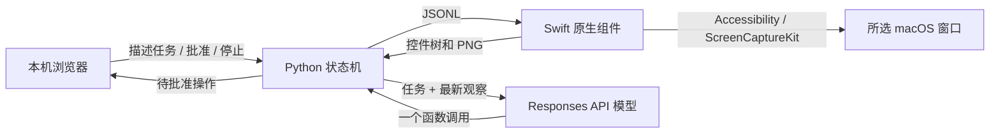

# 架构与协议

## 一次任务如何运行



每次开始任务时固定 `bundle_id + window_id`，不提供模型切换目标的工具。原生层同时绑定 PID 和窗口框架。每次观察生成一次性 `generation` 和本轮控件 ID；执行失败也使该 generation 失效。

观察结果同时包含窗口截图和辅助功能树。模型先看到新观察，返回一个 `computer_action` 或 `finish` 调用。Python 验证参数后生成随机建议 ID，等待页面批准。批准必须匹配当前建议 ID，不能重复使用。原生层重新核验窗口、位置、焦点和控件签名，执行后读取新的观察。

`finish` 表示模型结束本轮，可能是完成或遇到阻碍。界面显示原文，不把每次结束都标记为“成功”。状态机不会仅凭操作返回值确认目标已经完成。

## 各层职责

| 文件 | 职责 |
|---|---|
| `localcu/__main__.py` | 参数、白名单 `.env` 解析、本机启动 |
| `localcu/server.py` | 静态页面和鉴权 JSON API |
| `localcu/engine.py` | 单任务生命周期、批准、停止、超时、元数据审计 |
| `localcu/provider.py` | Responses API 请求、函数调用、工具结果与推理项历史 |
| `localcu/actions.py` | 独立参数校验和 strict JSON schema |
| `localcu/drivers.py` | 持久 Swift 子进程；独立的内存演示驱动 |
| `native/Sources/ComputerUseHelper/Helper.swift` | 窗口列表、AX 树、截图和系统动作 |

模型不会获得 Shell、文件读写、网络搜索、应用启动或任意快捷键函数。它只获得上述受限的窗口动作。但 GUI 本身可能提供命令输入和联网能力，这不是权限隔离沙箱；必须人工审查动作。

## 原生 JSONL

原生组件使用标准输入/输出，每一行是一个 JSON 对象。只在本机父子进程之间通信，不监听端口。标准输出专供协议。

请求示例（窗口 ID 与控件 ID 必须来自当前运行，下面是占位示例）：

```json
{"op":"doctor"}
{"op":"windows"}
{"op":"observe","bundle_id":"com.example.editor","window_id":123}
{"op":"act","bundle_id":"com.example.editor","window_id":123,"generation":"OBSERVATION_ID","action":{"kind":"click","element_id":"e12","reason":"点击按钮"}}
```

成功返回 `{"ok":true,"result":{...}}`；失败返回 `{"ok":false,"error":"..."}`。`request_permissions` 是界面明确点击时使用的操作，不在模型工具列表中。

观察结构：

```json
{
  "generation": "一次性观察 ID",
  "target": {"bundle_id": "com.example.editor", "pid": 1234, "window_id": 123,
             "title": "文档标题", "frame": {"x": 100, "y": 100, "width": 1000, "height": 700}},
  "elements": [{"id": "e1", "depth": 0, "role": "AXWindow", "title": "文档标题",
                "value": "", "enabled": true, "actions": []}],
  "truncated": false,
  "screenshot": {"width": 1000, "height": 700, "data_url": "data:image/png;base64,..."}
}
```

## 坐标与控件 ID

`x/y` 使用**最新截图像素坐标**，不是全屏坐标，不是 CSS 尺寸。原生层根据窗口逻辑框架换算：

```text
screenX = windowOriginX + imageX × windowLogicalWidth / imagePixelWidth
screenY = windowOriginY + imageY × windowLogicalHeight / imagePixelHeight
```

截图去除窗口阴影，按固定尺寸捕获。控件的 `frame` 则是相对于窗口原点的 macOS 逻辑点。模型应优先使用控件 ID，避免混淆这两种单位。

坐标点击与滚动必须通过 AX 命中测试，确认位置仍属于目标窗口。窗口移动或尺寸变化会使动作失败。控件动作重新比较角色、子角色、标题、描述和值，核验控件的所属窗口与可用状态。但任意界面仍可能在核验和输入之间改变；这是系统 UI 自动化的竞态边界。

## 模型上下文

每轮保留工具调用、对应 `function_call_output` 和模型的推理输出项。为支持无服务端会话存储的推理模型，请求 `reasoning.encrypted_content` 并原样传回；程序不尝试读取推理内容。

每轮仅保留最新的完整观察与图像，旧观察被占位说明替代，以限制重复图片开销。任务文本在每次新观察中重申。请求使用 `store:false`，但这不代表模型供应商绝不保留安全或服务日志，具体取决于供应商政策。

## 扩展方式

新的 Planner 实现 `next(observation, step)` 和 `feedback(result)`；新的 Driver 实现 `call(op, **args)` 与 `close()`。新动作需要同步更新 Python 参数约束、模型工具 schema、Swift 执行器和 UI 标签，并增加针对错误目标和停止行为的测试。
