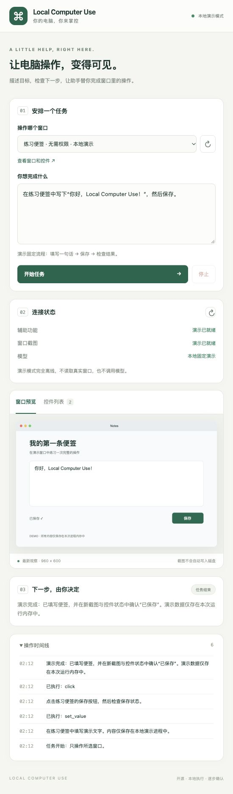

# 验证记录

初版验证日期：2026-10-12。

## 已完成

| 检查 | 环境 / 方法 | 结果 |
|---|---|---|
| Swift Release 编译 | macOS 26.0.1、Apple Silicon、Swift 6.2；项目目标最低 macOS 14 | 通过 |
| 原生 JSONL 冒烟 | `doctor`、非法操作、过期 generation；不请求权限、不执行 UI 动作 | 通过 |
| 只读权限与窗口列表 | 由本机进程调用原生组件 | 辅助功能可用、屏幕录制未授权；成功列出可见窗口 |
| Python 自动化测试 | Python 3.14.7，`unittest` 18 项 | 全部通过 |
| JavaScript 语法 | `node --check localcu/static/app.js` | 通过 |
| 浏览器演示闭环 | 本机页面：开始 → 批准填写 → 批准保存 → 检查新截图和控件 | 完成，显示“已保存”与两次已执行动作 |
| 窄窗口布局 | 本机浏览器 550 像素宽显示 | 表单、预览、操作面板按单列显示 |

## 自动化测试覆盖

- 截图坐标边界、非数值、NaN、Infinity 与布尔值误用。
- 失效、禁用、密码控件；未知动作、参数混用、超长输入、未允许快捷键。
- 一次性观察和目标绑定。
- 两次独立批准的完整演示闭环，以及最后观察中的保存状态。
- 错误 / 重复批准、拒绝、停止、批准过期、步数上限。
- 模型响应迟到时，不执行已经停止任务的动作；旧任务结束前不能开始新任务。
- 审计中不写入任务正文、输入文本或截图。
- Responses API 的工具结果、推理项传递和仅保留最新图像；拒绝多工具调用。
- 模型端点约束与重定向拒绝。
- HTTP 口令、Host、Origin、Fetch Metadata、静态文件边界和实际开始 / 拒绝请求。

## 尚未验证

1. **真实模型推理**：初版构建环境没有配置 API Key。接口按照公开文档实现，并用模拟响应测试；没有声称已经通过真实 API 调用。
2. **真实窗口截图与系统动作闭环**：新组件没有屏幕录制权限，未完成真实截图、点击、输入、滚动和模型联合测试。辅助功能可用不代表这些动作已通过实机验证。
3. 多显示器、非整数缩放、移动窗口、应用内浮层、中文输入法和不同辅助功能实现的全面兼容性。
4. 第三方 Responses API 兼容服务器。

## 授权后建议的实机验收

在空白练习文档中依次验证：窗口截图和控件一致；设置短文本；输入中文与 Emoji；坐标点击；上下滚动；按键；拒绝操作；运行中停止。故意移动窗口后再批准，应该收到重新观察提示，而不是继续使用旧坐标。

用真实模型完成一次“写入三条待办事项，不发送、不关闭窗口”的任务。检查最终截图和控件值确实符合目标。再扩展到实际工作应用。

仓库包含 GitHub Actions：Linux 上的 Python 版本矩阵和 macOS 原生编译 / 冒烟测试。CI 不申请 macOS 隐私权限，不测试真实 UI 操作。
